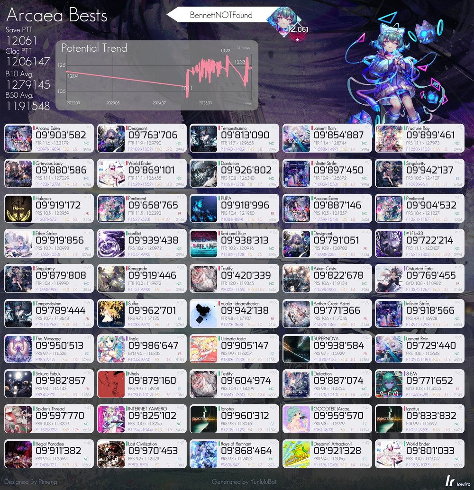

# arc-plugin

[](package.json)
[](https://github.com/yoimiya-kokomi/Yunzai-Bot)
[](package.json)

> 适用于云崽（Yunzai-Bot）的 Arcaea 查分插件 —— 绑定好友码，一键出 B50 成绩单与单曲成绩。



## ✨ 功能

- **B50 成绩单**：本地渲染高清成绩图，附潜力值趋势折线。
- **单曲查询**：支持曲名或 `song_id`，可指定难度。
- **冷却与兜底**：B50 冷却中或查询较慢时，自动先渲染上一次的数据。
- **在线资源同步**：曲绘、立绘等大件资源由 QentimArt 远端增量同步（首次启动自动拉取，`#a更新曲绘` 手动更新）；模板与曲名表随仓库发布。

## 📦 安装

> 本插件需要配合查分后端服务使用，请先准备好服务地址与 API Key。

1. 在云崽根目录克隆插件本体并安装依赖：

   ```bash
   #安装插件本体
   git clone --depth=1 https://github.com/OrbiterStellarTrek/arc-plugin.git ./plugins/arc-plugin/
   #进入插件目录
   cd ./plugins/arc-plugin/
   #安装插件所需依赖
   pnpm install -P
   ```

   > 如果安装依赖时速度过慢，先执行 `pnpm config set registry https://registry.npmmirror.com` 换用国内镜像源。

2. 安装渲染器（二选一，推荐 Shotium）：

   ```bash
   pnpm add @pixel.js/shotium -w
   ```

   ```bash
   pnpm add puppeteer -w
   ```

3. 重启云崽。首次加载会自动生成 `config/config.yaml`，按下方说明填写后再次重启即可。

## 🎮 命令

指令头默认为 `a`，支持 `#` 或 `/` 前缀（如 `#ab50`、`/ab50`）。

| 命令 | 说明 |
| --- | --- |
| `#a绑定 <9位好友码>` | 绑定 Arcaea 好友码 |
| `#a我的绑定` | 查看当前绑定 |
| `#a解绑` | 解除绑定 |
| `#ab50` | 查询 B50 成绩单 |
| `#ab50 上次` | 直接查看上一次的 B50（不发起新查询） |
| `#ab50cd` | 查看 B50 冷却剩余时间 |
| `#a查歌 <曲名或song_id> [难度]` | 查询单曲成绩，难度为 `PST/PRS/FTR/BYD/ETR` 或 `0-4`，默认 `FTR` |
| `#acalc <分数> <定数>` | 计算单曲潜力值（分数支持 `971w` 写法） |
| `#a状态` | 查看查分服务状态 |
| `#a曲绘版本` | 查看资源版本（本地已同步版本 / 服务端最新版本） |
| `#a更新曲绘` | 在线增量更新曲绘等渲染资源（仅主人，`#a更新曲绘 强制` 以服务端为准） |
| `#a帮助` | 查看帮助 |

> 曲名支持难度专属名称（如 `Axium Divergence` 会识别为对应曲目的 BYD）。识别不到时请直接使用 `song_id`。

## ⚙️ 配置

编辑 `config/config.yaml`（请勿修改 `config_default.yaml`）：

```yaml
server:
  base_url: "http://127.0.0.1:8080"   # 查分服务地址
  api_key: ""                         # API Key
  timeout_ms: 15000                   # 单次请求超时（毫秒）

cmdhead: "a"                          # 指令头

poll:
  max_wait_ms: 60000                  # 单曲查询最长等待（毫秒）
  b50_max_wait_ms: 180000             # B50 查询最长等待（毫秒）

b50:
  renderer: "auto"                    # auto | shotium | puppeteer
  scale: 3                            # 输出倍率，1 = 1000×1034
  type: "webp"                        # webp | png | jpeg
  quality: 95                         # 图片质量（webp / jpeg）

assets:
  base_url: "https://arcaea-resources.phira.link"  # 资源站（QentimArt 静态源，须用 https）
  concurrency: 8                      # 下载并发连接数（过高可能触发 CDN 503）
  local_changes: "keep"               # keep 保留本地改动 / overwrite 以服务端为准 / fail 冲突即报错
  timeout_ms: 60000                   # 单次 HTTP 超时（毫秒）
```

默认设置下 B50 图片为 3000×3102 的 WebP，约 2 MB，适合直接发群。

### 曲绘更新

曲绘（`original_ill/`）与立绘/字体/界面图（`assets/`）**不随仓库发布**，来自 [QentimArt](https://github.com/Pimeng/QentimArt) 静态资源站，按数据块增量同步。

- **首次启动自动拉取**：插件加载时若检测到曲绘/立绘缺失，会后台同步一次（非阻塞，失败不影响启动）。之后可发 `#a更新曲绘`（仅主人）手动更新；`#a曲绘版本` 查看本地/最新版本。
- 同步目标是 `resources/`，远端清单只含 `original_ill/` 与 `assets/`；模板（`html/`）与曲名表（`info/songlist.json`）随仓库发布、不在清单里，作为未跟踪文件被原样保留，更新绝不会动它们。
- 默认 `keep` 策略保留本地改动过的素材；`#a更新曲绘 强制`（或把 `local_changes` 设为 `overwrite`）则以服务端为准覆盖曲绘/立绘（仍不会删除 `html/`、`info/`）。
- 资源站地址务必用 `https`：官方站点会把 `http` 以 301 跳转到 `https`，而底层 SDK 不跟随跳转。

## 🛠️ 开发

### 渲染 API

插件入口导出了 B50 渲染函数，可在其他插件或脚本中复用：

```js
import { renderB30, shutdownRenderers, RENDER_DEFAULTS } from './index.js'

const img = await renderB30(raw)                          // 使用默认参数
const png = await renderB30(raw, { type: 'png', scale: 2 }) // 覆盖部分参数

await shutdownRenderers()                                 // 进程退出前释放渲染器
```

`RENDER_DEFAULTS` 为当前默认参数：`{ renderer: 'auto', scale: 3, type: 'webp', quality: 95 }`。`renderer: 'auto'` 会优先使用 Shotium，不可用时回退到 Puppeteer。

### 本地预览

使用示例数据（`tools/mock/b30.json`）渲染一张成绩图，无需连接后端：

```bash
node tools/render-preview.js
```

```bash
node tools/render-preview.js out.png --type=png --scale=2 --renderer=shotium
```

默认输出到 `tools/out/b30.webp`。

### 资源发布（维护者）

曲绘更新的远端源是一棵 [QentimArt](https://github.com/Pimeng/QentimArt) 静态分发树，**收录曲绘 `original_ill/` 与立绘/字体/界面图 `assets/`**（随游戏更新、体量大）；模板 `html/` 与曲名表 `info/songlist.json` 随仓库发布、不进分发树——下游以 `resources/` 为同步目标，这两样不在清单里、永不被动。

`tools/pack-resources.mjs` 会把 `resources/original_ill` 与 `resources/assets` 暂存后交给 `qentimart` 构建静态树。打包并发布（需 `qentimart` CLI 在 PATH、`wrangler` 已登录 Cloudflare）：

```bash
node tools/pack-resources.mjs 7.3.1
```

```bash
npx wrangler@latest pages deploy tools/out/arc-site --project-name <项目名> --branch <生产分支>
```

> 输出目录是 qentimart 的**持久镜像**：重复发布会累积多个版本，未变的 chunk 按内容哈希共享，历史版本几乎不额外占空间，`diff` / 回滚 / 指定版本都能用。已存在的版本号会被拒绝，请每次用新版本号；确需从零重建时加 `--fresh`。
>
> 发布流程：游戏更新后 `node tools/copy-assets.js <素材包>` 并入新资源 → 更新 `info/songlist.json`（提交 git）→ `node tools/pack-resources.mjs <新版本>` → 部署。

### 目录结构

```
arc-plugin/
├── index.js            # 插件入口
├── apps/               # 命令处理（绑定 / B50 / 单曲 / 帮助 / 资源更新）
├── config/             # 默认配置与用户配置
├── model/
│   ├── api/            # 查分服务客户端
│   ├── data/           # 成绩数据处理
│   ├── render/         # 渲染器（Shotium / Puppeteer）
│   └── assets.js       # 曲绘 / 资源在线增量更新（@qentimart/sdk）
├── resources/
│   ├── html/           # 渲染模板与样式 view.js / style.css（随仓库）
│   ├── info/           # 曲名表 songlist.json（随仓库）
│   ├── assets/         # 立绘、字体、界面图（远端同步，不入库）
│   └── original_ill/   # 曲绘（远端同步，不入库）
└── tools/              # 预览与资源维护脚本
```

## 🗺️ Roadmap

- [x] 完整曲库（含难度专属曲名与曲绘）
- [x] 曲绘 / 立绘在线增量更新
- [ ] 中文曲名别名

## 📄 License

[MIT](package.json)
